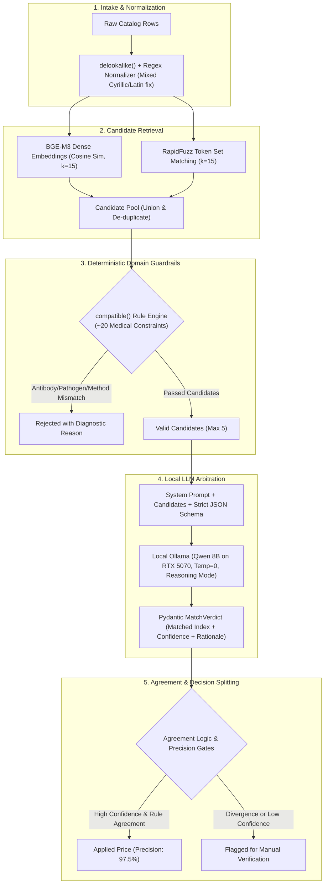
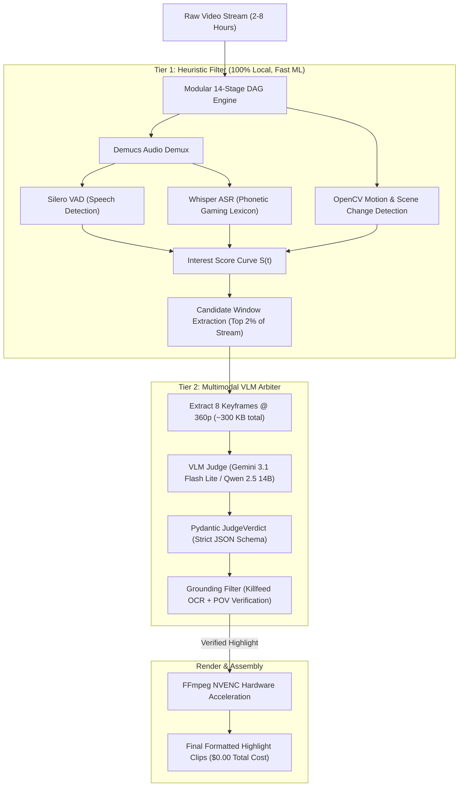
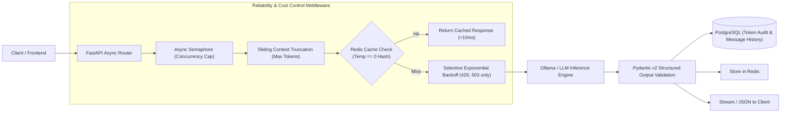

```mermaid
flowchart LR
    PDF["Patient PDF Blank"] --> Ext["pdfplumber / Regex Extraction"]
    Ext --> Val["Numeric Range & Unit Validator"]
    Val --> PII["De-identification Layer (Strip Name, Age, Order ID)"]
    PII --> Det["Deterministic Clinical Knowledge Engine"]
    
    subgraph CORE["Deterministic Decision Perimeter"]
        Det --> Flag["Evaluate Flags: Normal / Low / High"]
        Flag --> Synergies["Multi-marker Pattern Engine (e.g. Iron Deficiency Anemia)"]
        Synergies --> StructDoc["Validated Structured Medical Findings"]
    end
    
    StructDoc --> LLM["Local SLM (Summary Only)"]
    LLM --> PlainText["Patient-Facing Plain Summary"]
    StructDoc --> PlainText
```

# AI & LLM Systems Engineering Portfolio

**Mikhail (DelixeamI)**  
AI / LLM Systems Engineer · Production LLM Backend · Healthcare & Multimodal AI Platforms  
[GitHub](https://github.com/DelixeamI) · [Telegram](https://t.me/Mihail_r63) · [Email](mailto:mikhailivanovr@gmail.com) · Phone: [+7 (927) 899-24-96](tel:+79278992496)

This portfolio focuses on production-grade LLM reliability, deterministic guardrails, self-hosted local inference, hybrid retrieval (RAG), and data pipeline architectures. Sensitive medical records, proprietary business rules, and private infrastructure keys are omitted or de-identified.

---

## Production Profile & Highlights

- **2.5+ years of engineering production infrastructure & commercial systems**: Operating physical and virtual server clusters with Zabbix + Grafana, subnet isolation, enterprise EDS/security, and custom Python LIS (Laboratory Information System) integration drivers.
- **High-Precision Cross-Catalog RAG (`lab-price-matcher`)**: Architected a 3-tier matching pipeline (`retrieve → filter → judge`) aligning 2,300+ medical services to 656 internal records with **97.5% Precision** and **88.1% Catalog Coverage** on an offline ground-truth benchmark.
- **Zero-Hallucination Clinical Report MVP (`skylab-med-ai`)**: Built a medical test interpretation engine where numeric validation and range boundaries are **100% deterministic**; protected by **218 automated unit tests** and strict PII de-identification.
- **High-Throughput Multimodal Video Pipeline (`stream-highlight-harvester`)**: Developed a 14-stage DAG with SHA-256 content-addressable caching, processing long streams at **6.5x real-time speed** and **$0.00 compute cost** via local Whisper ASR, Silero VAD, and compact VLM keyframe arbitration.
- **Hardened Async LLM Gateway (`llm-chat-api`)**: Implemented an async FastAPI gateway with Redis zero-temperature response caching, sliding context management, and strict Pydantic v2 structured outputs (100% schema conformance across 142 tests).

---

## Case 1: Cross-Catalog Lab Price Matcher (Hybrid RAG & Local Judge)

### Problem Statement
A medical laboratory needed to map its 656 internal laboratory services to a competitor's catalog of 2,300+ entries to normalize pricing. Medical tests cannot be matched naively with fuzzy string matching:
- Subtle character differences change clinical meaning (*IgM* vs *IgG* antibodies, Type 1 vs Type 2 viruses).
- Methodologies dictate different pricing (*qualitative* vs *quantitative* PCR).
- Bundles vs individual markers (*Serotonin* alone vs *Catecholamines and Serotonin* panel).
- An erroneous match produces a false commercial price; therefore, **false matches are strictly unacceptable (precision is paramount)**. Furthermore, price catalogs contain sensitive business data that must not leave the internal perimeter.

### System Architecture



### Key Engineering Decisions & Trade-Offs

1. **Why Hybrid Search (BGE-M3 + RapidFuzz)**:
   - Pure dense vector search frequently confuses specific clinical acronyms (*IgA* vs *IgM* have high cosine similarity).
   - Pure lexical search fails when synonyms and word orders vary (*"ОАК с лейкоцитарной формулой"* vs *"Клинический анализ крови развернутый"*).
   - Combining BGE-M3 with RapidFuzz provided robust recall across both semantic rephrasing and exact clinical terms.
2. **Deterministic Filters Before the Model**:
   - Rather than asking the LLM to verify all ~20 medical compatibility rules in prompt space, `compatible()` enforces them in Python code.
   - Any mismatch in antibody class, specimen type (venous vs capillary blood), or methodology immediately rejects the pair before wasting GPU tokens.
3. **Local Reasoning Model (`qwen3:8b` via Ollama)**:
   - Operating locally on an RTX 5070 ensures proprietary laboratory pricing remains air-gapped.
   - Enabling internal reasoning before generating JSON output reduced false matches from **29 to 3**.
4. **Offline Evaluation Benchmark (196 Ground-Truth Pairs)**:
   - Double-annotated using historical human assignments and cross-validation with Gemini, manually reconciled.
   - Monitored exact precision: V1 heuristic baseline was 96.2%; V2 hybrid pipeline reached **97.5% Precision** with **88.1% catalog coverage** (578/656 items mapped with guaranteed accuracy).

---

## Case 2: SkyLab Med AI (Zero-Hallucination Clinical Report Interpretation)

### Problem Statement
Patients often receive multi-page laboratory test reports containing dense numeric tables, reference ranges, and medical terminology. They need a plain-language explanation of which markers are outside normal limits and how related indicators correlate.
- **Critical Risk**: An LLM hallucinating reference ranges, fabricating values, or giving clinical diagnoses can cause serious medical harm.
- **Privacy Constraint**: Patient Personal Identifiable Information (PII) and Protected Health Information (PHI) must never be transmitted to third-party endpoints.

### System Architecture



### Key Engineering Decisions & Trade-Offs

1. **Strictly Decoupled Intelligence**:
   - The LLM **never calculates or checks numbers**. Flagging a marker as "High", "Low", or "Normal" is executed 100% deterministically against verified laboratory reference intervals.
   - The LLM is restricted to a read-only role: transforming pre-calculated findings into empathetic, plain-language Russian summaries.
2. **De-identification Boundary**:
   - All patient metadata (full name, birthdate, medical record number, barcode) is stripped before any text enters memory or LLM contexts.
3. **218 Automated Unit Tests**:
   - Exhaustive test suite covering boundary values (e.g., value exactly matching upper reference limit), unit conversions, and corrupted PDF extraction artifacts.
   - Silent error tracking ensuring missing fields fail safely with clear audit logs instead of speculative filling.

---

## Case 3: Stream Highlight Harvester (Multimodal 2-Tier DAG Pipeline)

### Problem Statement
Creating montage clips from 2–8 hour live streams requires detecting genuine high-action events (kills, duels, clutches).
- **The Naive Approach Fails**: Audio-only triggers flag screaming or music spikes as "action" (high false positives). Sending hours of raw video to commercial cloud multimodal models costs ~$40+ per stream and takes hours to transfer.
- **The Solution**: A multi-tier cascade running locally on consumer hardware.

### System Architecture



### Key Engineering Decisions & Trade-Offs

1. **Content-Addressed SHA-256 DAG Caching**:
   - Each of the 14 stages computes a deterministic hash of its inputs, parameters, and stage code version.
   - Heavy compute stages (Whisper transcription, audio separation) never re-run if earlier stages didn't change, enabling instant resume after adjustments.
2. **Keyframe Packing Instead of Video Ingestion**:
   - Instead of streaming gigabytes of raw video, the pipeline extracts exactly 8 keyframes per candidate window at 360p (~300 KB).
   - This provides the VLM with visual ground truth (killfeed, UI elements, player perspective) without network bottlenecks or high compute costs.
3. **Structured VLM Output with Pydantic**:
   - The model must return an exact schema specifying action category, timestamp anchor, confidence score, and visual evidence.
   - Invalid responses trigger an automated repair cycle before passing to the video renderer.
4. **Performance**:
   - 3.5-hour stream analyzed in **28 minutes (6.5x real-time)** with **113 passing unit tests**.

---

## Case 4: High-Reliability Async LLM Gateway (`llm-chat-api`)

### Problem Statement
Connecting user-facing backends to LLM providers creates serious availability and latency bottlenecks:
- LLM response times are highly variable (1s to 30s).
- Rate limits (429) and provider downtime (503) cause cascading failures.
- Unbounded conversations cause token blowouts and high costs.
- Free-form text outputs break downstream frontend and database schemas.

### Reliability Architecture & Implementations



### Key Engineering Decisions

1. **Zero-Temperature Deterministic Caching**:
   - When requests specify `temperature: 0`, prompt hashes are evaluated in Redis. Identical requests return cached responses in under 10ms with zero token cost.
2. **Selective Retry Logic**:
   - Retries with jittered exponential backoff are strictly applied to transient network or capacity errors (HTTP 429, 503).
   - Client format errors (400) or schema validation failures are never naively retried; they are caught immediately or routed through a correction cycle.
3. **Structured Outputs (100% Validation Rate)**:
   - Evaluated prompt-only vs JSON Schema constrained decoding. Prompt-only requests failed validation in edge cases; JSON Schema enforcement guaranteed **12/12 valid structured payloads**.
4. **Code Quality**:
   - Built with strict static typing (`mypy --strict`), comprehensive integration tests (`pytest`), and containerized via Docker Compose with PostgreSQL and Redis.

---

## Systems & Infrastructure Matrix

```
┌─────────────────────────────────────────────────────────────────────────────┐
│                 Systems Engineering & Reliability Standards                 │
├─────────────────────┬───────────────────────────────────────────────────────┤
│ Infrastructure      │ Linux (Ubuntu/Debian), Docker Compose, Shell Scripting │
│ Cluster Monitoring  │ Zabbix + Grafana (Host metrics, alert triggers)       │
│ Network Engineering │ VLAN segmentation, secure internal network topologies │
│ Cryptography & Auth │ Digital Signature Infrastructure (EDS/ЭЦП, Gost crypto)│
│ MedTech Protocols   │ Serial (RS-232), Socket streams, LIS data exchange    │
│ LLM Serving         │ Ollama on RTX 5070, CUDA acceleration, vLLM patterns  │
└─────────────────────┴───────────────────────────────────────────────────────┘
```
