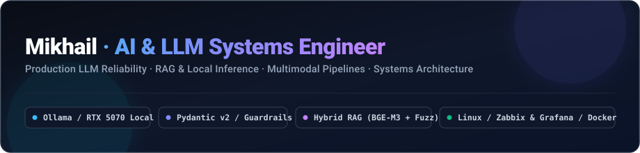
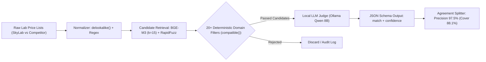
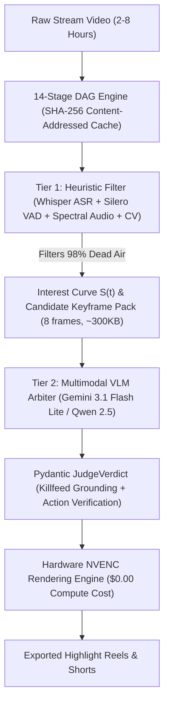

<div align="center">



[](https://t.me/your_handle)
[](mailto:mihail_jackson@list.ru)
[](https://github.com/DelixeamI)
[](AI_LLM_PORTFOLIO.md)
[](CASE_STUDIES.md)
[](CV.md)

<br/>


<br/>

**Telegram [@your_handle](https://t.me/your_handle) · [mihail_jackson@list.ru](mailto:mihail_jackson@list.ru) · Russia · Open to Remote (Middle AI / LLM Engineer)**

</div>

---

## ⚡ Profile & Engineering Philosophy

I am an **AI / LLM Systems Engineer** focused on production LLM reliability, deterministic guardrails, self-hosted local inference, and high-performance backend pipelines.

With **2.5+ years of production infrastructure engineering** (Linux, Docker, Zabbix/Grafana cluster monitoring, subnet isolation, InfoSec/EDS) and **commercial Python backend experience in Healthcare** (LIS integration and medical analyzer stream protocols), I bridge the gap between probabilistic machine learning and mission-critical production systems.

I treat LLMs not as magic oracles, but as **slow, probabilistic, untrusted external dependencies**. Building around them requires:
- **Zero-trust data boundaries**: Pydantic v2 strict schemas, JSON Schema constrained decoding, and runtime validation.
- **Deterministic-first architectures**: Heavy lifting, safety checks, and medical thresholds remain deterministic; LLMs are isolated to synthesis and nuanced arbitration.
- **Privacy & offline perimeters**: Air-gapped and local self-hosted inference (Ollama on RTX 5070, BGE-M3 embeddings, Qwen 2.5/3) ensuring sensitive commercial and patient data never leaves the local perimeter.
- **Quantitative evaluation**: Every pipeline decision is proven with labeled benchmarks, precision/recall tracking, and silent error metrics rather than "vibe checks".

---

## 🚀 Selected Production & Engineering Results

- **97.5% Precision on 196-Item Clinical Benchmark** ([`lab-price-matcher`](https://github.com/DelixeamI/lab-price-matcher)): Built a 3-tier matching pipeline (`retrieve → filter → judge`) aligning 2,300+ medical services against 656 internal records. Local reasoning model (`qwen3:8b`) dropped false positive pairs from **29 to 3**, achieving **88.1% price catalog coverage**.
- **Zero-Hallucination Clinical MVP** ([`skylab-med-ai`](AI_LLM_PORTFOLIO.md#case-2-skylab-med-ai-zero-hallucination-clinical-report-interpretation)): Architected a 5-layer diagnostic report interpreter. Ensured 100% deterministic numeric checks and PII de-identification before generating patient summaries. Guarded by **218 automated unit tests**.
- **6.5x Real-Time Multimodal Pipeline at $0.00 API Cost** ([`stream-highlight-harvester`](https://github.com/DelixeamI/stream-highlight-harvester)): Designed a 2-tier DAG engine for processing 2–8 hour video streams. Fast deterministic ML (Whisper ASR, Silero VAD, CV motion) filters **98% of dead time**, while a multimodal VLM arbiter verifies keyframe killfeeds with strict Pydantic output.
- **Production Async LLM Gateway** ([`llm-chat-api`](https://github.com/DelixeamI/llm-chat-api)): Built an asynchronous FastAPI service with Redis caching for zero-temperature responses, semaphore-based concurrency caps, token-cost metering, and sliding-window context management. Tested under `mypy --strict` with **142 tests**.
- **Mission-Critical Systems & LIS Integration** (SkyLab Laboratory): Developed custom Python drivers interfacing with automated medical analyzers (raw serial/socket stream parsing). Deployed end-to-end telemetry across physical and virtual servers using **Zabbix + Grafana**.

---

## 🛠️ Featured Engineering Work

### 1. [lab-price-matcher: Hybrid RAG & Domain-Constrained LLM Judge](https://github.com/DelixeamI/lab-price-matcher)
> **Stack**: Python 3.12 · Ollama (`qwen3:8b`) · BGE-M3 Embeddings · RapidFuzz · Pydantic · Offline Evals



- **Problem**: Synchronizing pricing across competing medical laboratories with incompatible test codes and naming discrepancies (e.g., *IgM* vs *IgG*, qualitative vs quantitative PCR, multi-marker panels vs single assays). A wrong match publishes an incorrect clinical price.
- **Architecture**: `Retrieve → Filter → Judge`. Dense vector search (`bge-m3`) and fuzzy token matching propose top candidates; a deterministic rule engine (`compatible()`) enforces ~20 medical constraints before invoking the model; local `qwen3:8b` running in Ollama on an RTX 5070 performs final arbitration.
- **Key Engineering**: Enabled model reasoning mode, reducing false pairs from **29 to 3**. Verified on an offline double-annotated ground-truth benchmark (196 tests).

---

### 2. [skylab-med-ai: Clinical Report Interpreter with Zero Hallucination](AI_LLM_PORTFOLIO.md#case-2-skylab-med-ai-zero-hallucination-clinical-report-interpretation)
> **Stack**: Python 3.12 · PDF Extraction · Deterministic Medical Rule Engine · PII Masking · Local SLM Summary · 218 Tests

```mermaid
flowchart LR
    P["Patient PDF Lab Report"] --> Ext["PDF Plumber / Text Extraction"]
    Ext --> Val["Regex & Numeric Range Validator"]
    Val --> PII["De-identification (Strip Name, DoB, IDs)"]
    PII --> Rules["Deterministic Clinical Knowledge Engine"]
    Rules --> Rpt["Structured Reference Output"]
    Rpt --> LLM["Local SLM (Summary Only, No Decisions)"]
    LLM --> Out["Validated Plain-Language Patient Summary"]
```



- **Problem**: Delivering clear, accessible lab test interpretations to patients without risking dangerous LLM medical hallucinations or leaking protected health information (PHI).
- **Architecture**: Strict decoupling. Medical reference ranges, flag evaluations (normal/elevated/depleted), and diagnostic groupings are **100% deterministic**. The local LLM is only utilized to draft a non-diagnostic executive summary.
- **Reliability & Testing**: **218 unit tests** verify boundary numbers, edge cases, and silent failure rates. All patient identifiers are completely stripped prior to entering memory.

---

### 3. [stream-highlight-harvester: Multimodal 14-Stage DAG Pipeline](https://github.com/DelixeamI/stream-highlight-harvester)
> **Stack**: Python 3.12 · Whisper ASR · Silero VAD · OpenCV · Multimodal Video-VLM · NVENC HW Render · DAG Engine



- **Problem**: Finding high-energy highlight moments in long gaming VODs without paying massive cloud multimodal processing fees (~$40/stream) or falling for false audio triggers (screams from falling off ladders).
- **Architecture**: Two-tier cascade. Tier 1 uses lightweight CPU/GPU models (Whisper with custom phonetic dictionary, Silero voice detection, motion vectors) to eliminate 98% of dead air. Tier 2 sends compact 8-frame keyframe bundles to a multimodal VLM arbiter for strict visual verification.
- **Performance**: Processes 3.5-hour streams in **28 minutes (6.5x real-time)** at **$0.00 cost**, protected by 113 DAG tests.

---

### 4. [llm-chat-api: Production-Grade Async LLM Gateway](https://github.com/DelixeamI/llm-chat-api)
> **Stack**: Python 3.12 · FastAPI · Pydantic v2 · PostgreSQL · Redis · Ollama · Docker Compose · mypy --strict

- **Reliability Layer**: Concurrency rate-limiting via async semaphores, per-request token budgets, sliding-window context truncation, and selective retries with exponential backoff for transient errors (429, 503).
- **Cost & Latency Optimization**: Deterministic Redis caching for zero-temperature requests; token counting and cost attribution stored in PostgreSQL.
- **Strict Typing & Testing**: Enforces JSON Schema structured outputs (100% schema conformance on test suites), 142 automated tests, strict mypy validation.

---

## 🏛️ Infrastructure & Systems Engineering Foundations

My background in **Systems Administration & IT Security** at SkyLab provides a strong operational foundation:

```
┌────────────────────────────────────────────────────────────────────────┐
│                   Production Infrastructure Matrix                     │
├──────────────────────────┬─────────────────────────────────────────────┤
│ Cluster Monitoring       │ Zabbix + Grafana (virtual & physical hosts) │
│ Containerization         │ Docker, Docker Compose, Multi-stage builds  │
│ Network & Security       │ Subnet segmentation (Staff vs Public VLANs) │
│ Identity & Encryption    │ Digital Signature Infrastructure (EDS/ЭЦП)  │
│ Hardware Integration     │ Serial / TCP Python drivers for LIS Analyzers│
│ Local Compute Inference  │ Dedicated RTX 5070 running Ollama / vLLM    │
└──────────────────────────┴─────────────────────────────────────────────┘
```

---

## 🧰 Technical Skills

| Domain | Technologies & Frameworks |
|---|---|
| **AI / LLM Engineering** | Ollama, Local Qwen 2.5/3, Gemini API, PyTorch, LangGraph concepts, Structured Outputs, JSON Schema, Prompt Engineering, Guardrails |
| **RAG & Retrieval** | BGE-M3 Embeddings, Vector Similarity, Cosine Distance, RapidFuzz, Candidate Filtering, Hybrid Search, Offline Evaluation |
| **Backend & Architecture** | Python 3.12, FastAPI, AsyncIO, Pydantic v2, REST APIs, Streaming Responses, DAG Pipeline Engines, Modular Architecture |
| **Databases & Caching** | PostgreSQL (Relational schema, transactions), Redis (Response cache, semaphores, rate limiting) |
| **DevOps & Infrastructure** | Linux (Ubuntu/Debian), Docker, Docker Compose, Zabbix, Grafana, Git, GitHub Actions CI/CD |
| **Testing & Quality** | Pytest, Unittest, Mypy (strict), Benchmarking, Precision/Recall offline evals, Silent error metrics |

---

## 📚 Portfolio Documentation & Case Studies

- 📖 **[Detailed AI Engineering Portfolio (AI_LLM_PORTFOLIO.md)](AI_LLM_PORTFOLIO.md)**: In-depth breakdown of state orchestration, Pydantic contracts, deterministic fallback chains, and retrieval evaluation.
- 🔬 **[Engineering Case Studies (CASE_STUDIES.md)](CASE_STUDIES.md)**: Real-world problems, trade-offs, architecture decisions, and business impact from healthcare and AI pipelines.
- 📄 **[Curriculum Vitae (CV.md)](CV.md)**: Concise, professional resume formatted for engineering hiring managers.

---

<div align="center">
  <sub>Engineered with precision, test-driven validation, and zero-trust LLM guardrails.</sub>
</div>
